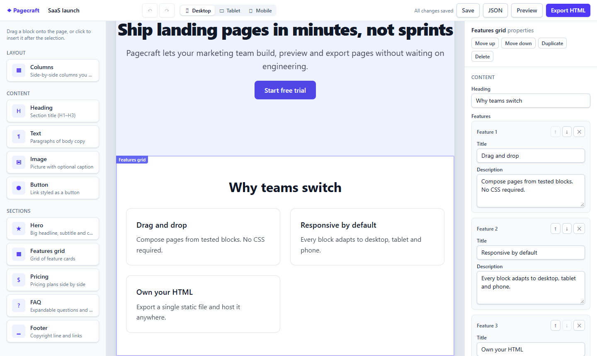

# Pagecraft

A drag-and-drop landing page builder. Drag blocks onto a canvas, edit text and styles, preview on desktop / tablet / mobile, save pages in the browser, and export a single static HTML file.



**Stack:** Next.js 16 (App Router) · React 19 · TypeScript (strict) · Tailwind CSS 4 · Zustand 5 · dnd-kit · Vitest + React Testing Library · Vite (export package) · GitHub Actions

## Features

| | |
|---|---|
| **Blocks** | Hero, Heading, Text, Image, Button, Columns, Features grid, Pricing, FAQ, Footer |
| **Canvas** | dnd-kit: drag from the palette, reorder, nest blocks inside Columns, move between columns. Drop-line indicator and drag overlay |
| **Properties** | Per-block content fields generated from the block registry (text, URLs, selects, list editors for features / plans / FAQs / links) plus style: text colour, background, padding, font size, alignment. Column count 1–4 |
| **Responsive** | Desktop / tablet / mobile toggle. The canvas uses CSS container queries, so blocks reflow at the chosen width. **Preview** renders the exported HTML in a sandboxed `<iframe>` at device width |
| **Undo / redo** | `Ctrl+Z` / `Ctrl+Shift+Z` (`Ctrl+Y`). 100-step snapshot history; a burst of typing in one field is one undo step |
| **Save / load** | Debounced autosave to `localStorage`, multiple pages, JSON download and validated JSON import |
| **Export** | One self-contained `.html` file: escaped text, whitelisted URL schemes and colours, no JavaScript |
| **Templates** | SaaS launch, Conference, Mobile app (plus a hidden 210-block stress page for profiling) |
| **Keyboard** | `↑/↓` select, `Alt+↑/↓` move, `Ctrl+D` duplicate, `Delete` remove, `Esc` deselect, `Ctrl+S` save. Palette items insert on `Enter` |

## Getting started

```bash
npm install
npm run dev          # http://localhost:3000
```

| Script | |
|---|---|
| `npm run dev` / `build` / `start` | Next.js |
| `npm test` / `test:coverage` | Vitest unit + component tests |
| `npm run lint` / `typecheck` | ESLint, `tsc --noEmit` |
| `npm run build:export` | Vite library build of `@pagecraft/export` → `packages/export/dist` |
| `npm run analyze` | Webpack bundle analyzer (`.next/analyze/client.html`) |
| `npm run perf` | jsdom re-render benchmark → `perf/results/jsdom-<PERF_LABEL>.json` |
| `npm run perf:browser -- <url>` | Chrome benchmark against a running production build (needs local Chrome) |
| `node perf/lighthouse.mjs <url>` | Lighthouse ×3, median → `perf/results/lighthouse-<PERF_LABEL>.json` |

URLs: `/` lists pages and templates. `/editor?template=saas` creates a page from a template. `/editor?id=<pageId>` opens a saved page.

## Architecture

```
packages/export/        @pagecraft/export: schema types, HTML renderer, shared CSS (Vite library build)
  src/schema.ts         Block / PageDocument types (discriminated union)
  src/render.ts         per-block markup, used by the editor canvas AND the exporter
  src/html.ts           full-document export (subpath @pagecraft/export/html, code-split)
  src/css.ts            one stylesheet for canvas + export, responsive via container queries
src/
  blocks/               registry (defaults, fields, nesting rules), templates, ARIA summaries
  store/tree.ts         pure, immutable tree operations
  store/editor.ts       Zustand store: document, selection, history, UI state
  store/context.tsx     store provided through React context (isolated stores in tests)
  components/editor/    Editor (DndContext), Canvas, Palette, PropertiesPanel, Toolbar, Preview …
  lib/storage.ts        localStorage persistence + document validation / repair
perf/                   benchmarks and recorded results
```

**State: a normalized block tree.** `blocks: Record<id, Block>` plus `rootIds`. Each block stores its `parentId` and ordered `children`. A `columns` block owns `column` children, and only those hold content. Nesting rules live in one function (`canContain`): columns can't go inside columns, and columns can't be dragged out on their own.

**Tree operations are pure and structurally shared** (`store/tree.ts`). An edit replaces only the touched block object and its parent's child list. Every other block keeps its identity, which is what makes per-block memoization work. No-ops return the same tree, so they don't create history entries.

**History** stores `{rootIds, blocks}` snapshots. Thanks to structural sharing, a snapshot costs one object per changed block, not a deep copy. Edits can carry a `coalesceKey` (`blockId:field`) so typing within one second in the same field becomes one undo step.

**One renderer, two outputs.** The canvas renders each leaf block's markup with the same `renderBlockContent` the exporter uses, and both use the same CSS. What you edit is what you export. Responsiveness uses `@container` queries on `.pc-page`, so the same CSS responds to the canvas width in the editor and to the viewport in an exported file.

**Drag and drop.** Nested droppables overlap, so a custom collision detector picks the *smallest* droppable under the pointer and ignores the dragged block's own subtree. Drop resolution (`resolveDropTarget`, `toMoveIndex`) is a pure function with unit tests.

**Why the canvas is not inside an iframe.** dnd-kit can't drag from the palette in the parent document into an iframe document, because pointer events don't cross frames. Container queries give the canvas real responsive behaviour without one. The **Preview** button does use a sandboxed iframe, showing the actual exported HTML at device width.

## Accessibility

- The canvas is a `tree` of `treeitem`s with `aria-level`, `aria-selected` and descriptive labels (e.g. "Heading: Section heading"). It uses a roving tabindex, so the canvas is one tab stop.
- Every drag action has a keyboard equivalent: palette items insert on `Enter`, and blocks move with `Alt+↑/↓`. Actions are announced through a polite live region. dnd-kit announcements cover pointer drags.
- All panel inputs have labels; list items are labelled groups; alignment is a radio group; the preview is a native modal `<dialog>`.
- Shortcuts are ignored while typing in a field, except undo/redo and save.

## Testing

**85 tests** (Vitest + React Testing Library), **88.6% statements / 91.8% lines** covered (`npm run test:coverage`).

- **Store:** add, nest, move (same list, across containers, illegal moves), delete with selection fallback, deep duplicate, column count changes, undo/redo, typing coalescing, history cap.
- **Drop resolution:** before/after/inside, illegal targets, index correction.
- **Export:** escaping, `javascript:` URLs, CSS injection through colours, every block type, cyclic-tree guard.
- **Persistence:** round trip, corrupt data, quota errors, import validation and repair.
- **Components:** canvas rendering and selection, keyboard shortcuts, properties panel (fields, list editor, style, columns), toolbar, autosave, export downloads, preview dialog, route loading, home page.

Drag gestures depend on layout, which jsdom doesn't do, so they were verified in real Chrome with Playwright during development (palette → canvas, reorder, nest into a column, move between columns).

## Performance case study

I built the naive version first on purpose, measured it, optimized, and measured again. All numbers below come from the JSON files in [`perf/results/`](perf/results/). Naive and optimized were measured **in the same session, on the same machine**, with the same scripts. The naive numbers come from a worktree of the naive commit (`2fce61d`).

**Test page:** the stress template, **210 blocks** (30 sections of heading, text, and a 2-column block with content).

### What the naive version did

`Canvas` subscribed to the whole `blocks` map and selection and passed them down as props, with no memoization. Any edit (a keystroke, a selection change, the drop indicator moving during a drag) re-rendered every block.

### Fixes

1. **Selector-based subscriptions + `React.memo`.** `BlockNode` takes only `{id, level}` and subscribes to *its own* block, a boolean `isSelected`, and its own drop-indicator slot.
2. **Split the dnd-kit hooks from the content.** dnd-kit re-renders every `useDraggable`/`useDroppable` consumer when the drag target changes. The hooks sit in a thin wrapper; markup and children live in a memoized `BlockBody` that only re-renders when its block object changes.
3. **A bug found by measuring in the browser, not jsdom.** After steps 1–2, the jsdom benchmark looked fixed, but production render counts in Chrome still showed **210 block re-renders per keystroke**. Cause: autosave status was React state in the route component. Each keystroke re-rendered the shell and `DndContext`, which received an inline `accessibility={{…}}` object, and that fanned out to every block. Fix: save status lives in the store (only the status label subscribes), and the prop is memoized. I then changed the benchmark to render the real route so it can't miss this again.
4. **Code splitting.** The full-document HTML renderer moved to `@pagecraft/export/html` and loads, together with the preview dialog, on first use.
5. **Lazy-loading the palette: tried and reverted.** The palette is visible on first paint, so splitting it deferred nothing. Measured, it added a request, and Turbopack duplicated shared modules (registry, store) into the new chunk group.

### Results

**Re-renders per update** (React Profiler, jsdom, React dev build; real `EditorRoute` with only `next/navigation` mocked; median of 40)

| Interaction | Naive: components rendered | Optimized: components rendered | Naive commit | Optimized commit |
|---|---|---|---|---|
| Type one character | 210 blocks + canvas + panel + 10 palette items | 1 block + panel | 208.8 ms | 8.1 ms |
| Change selection | 210 blocks + canvas + panel | 2 blocks + panel | 168.9 ms | 9.6 ms |
| Drop indicator moves | 210 blocks + canvas | 2 blocks | 169.4 ms | 1.1 ms |
| Change a style value | 210 blocks + canvas + panel + 10 palette items | 1 block + panel | 198.0 ms | 7.8 ms |

**Block re-renders per keystroke: 210 → 1 (−99.5%).** Profiler commit time per keystroke: 208.8 → 8.1 ms (−96%). jsdom dev-mode milliseconds are for comparing the two versions, not absolute speed.

**Typing in real Chrome** (production build, Event Timing API, typing 40 characters into a text field, 5 runs)

| | Naive | Optimized |
|---|---|---|
| Time to type 40 characters (median) | 1198 ms | **396 ms (−67%)** |
| Median duration of slow (>16 ms) input events | 32 ms | 16 ms |
| p95 | 56 ms | 24 ms |
| Worst event | 160 ms | 40 ms |

Input events still cross 16 ms on this page. What's left is layout/paint of a 210-block page plus the panel, not React work.

**What did not improve (also measured, reported as-is):**

| | Naive | Optimized | Notes |
|---|---|---|---|
| Lighthouse performance, desktop, stress page (median of 3) | 72 | 71 | Within noise |
| Total Blocking Time | 691 ms | 792 ms | Run ranges overlap (539–1033 vs 582–820). Load cost is mounting 210 blocks × dnd-kit hooks, which memoization doesn't reduce |
| Drag across the page, long-animation-frame blocking (median of 5) | 131 ms | 214 ms | Very noisy (82–152 vs 84–291). Dominated by dnd-kit measuring ~420 droppable rects |
| JS transferred loading the editor (Turbopack build, at network idle) | 171.3 KB | 182.0 KB | The split worked (HTML renderer and preview no longer load up front), but Turbopack now gives the prefetched home route its own copy of shared modules |
| Editor route chunk (webpack analyzer) | 12.1 KB gzip | 11.6 KB gzip | −0.5 KB. The app's own code is small; most bytes are React/Next and dnd-kit (41 KB parsed) |

**Takeaways:** memoization fixed the interaction path it targeted, and fixed it decisively. It did nothing for load time, and code splitting saved no meaningful bytes here. The next steps for load and drag would be virtualizing or `content-visibility` for off-screen blocks, and registering droppables only for the visible part of a long page.

### Reproduce

```bash
PERF_LABEL=mine npm run perf                         # jsdom, writes perf/results/jsdom-mine.json
npm run build && npm start                           # in another terminal
PERF_LABEL=mine node perf/browser.mjs http://localhost:3000
PERF_LABEL=mine node perf/lighthouse.mjs http://localhost:3000
```

`browser.mjs` and `lighthouse.mjs` look for Chrome at the default Windows path; set `CHROME_PATH` elsewhere.

## CI and deployment

`.github/workflows/ci.yml` runs on every push to `main` and every PR: `npm ci` → lint → typecheck → tests with coverage (uploaded as an artifact) → Vite build of the export package → Next.js production build.

**Deploy to Vercel:** import the repository in Vercel. It detects Next.js; no environment variables are needed, because all data lives in the browser's `localStorage`.

## Git workflow

Work happened on feature branches merged into `main` with `--no-ff`, as PRs would be: `feat/export-package`, `feat/store`, `feat/canvas`, `feat/editor-features`, `perf/measure-baseline`, `perf/optimize`, `chore/ci-readme`. `git log --graph` shows the history, including the naive baseline commit the performance numbers were measured against.

## How I used Claude Code, and what I verified

I built this with Claude Code (Anthropic's agentic coding CLI) doing most of the typing: scaffolding, components, tests, and the benchmark scripts. The things I checked rather than trusted:

- **Behaviour in a real browser, not just tests.** Playwright scripts drove real Chrome for drag-and-drop (palette → canvas, reorder, nest, move between columns), the edit → undo → redo → preview → export → reload flow, and screenshots of the canvas and the mobile preview.
- **Every performance number is measured.** The jsdom benchmark initially missed the shell-wide re-render bug (it rendered a partial tree). Production render counts in Chrome caught it, and the harness was then changed to render the real route. A median that ignored zero-render iterations was also caught and fixed before any numbers were recorded.
- **Negative results stay in.** Lazy-loading the palette made things worse and was reverted. Bundle size, TBT and drag blocking did not improve, and the tables above say so.
- **Bugs the tests surfaced:** number inputs clamped mid-keystroke (typing "18" with a minimum of 10 became 48), and a Zustand selector returned a new object each call, which would have looped under `useSyncExternalStore`.
- **Gates on every change:** `tsc --noEmit` (strict, `noUncheckedIndexedAccess`), ESLint (including the React Compiler rules), the full test suite, and a production build.

## Known limitations

- Pages live in `localStorage` (~5 MB per origin, single device). Use JSON export for backups.
- Images are referenced by URL; there is no upload.
- Keyboard moves (`Alt+↑/↓`) stay within the block's current container. Moving an existing block *into* a column needs a pointer drag. New blocks can be added to a column from the keyboard by selecting the column and pressing `Enter` on a palette item.
- Lighthouse and the browser benchmark are local measurements on one machine; absolute values vary between runs.
